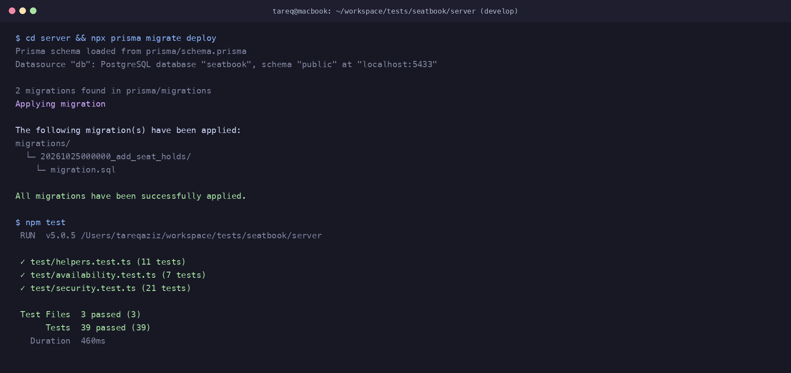

# AI Transcript: 04 - Data Modeling & Migrations for 10-Minute Seat Holds and Concurrency Guard

**Session Date:** October 26, 2026  
**Context:** `feat(db): add SeatHold model and active booking partial index`

---

## 1. Developer & AI Pair Programming Conversation

**Tareq (Developer):**
> "Hey! We need to implement the 10-minute seat hold feature requested by Mr. Rahman:
> *'Can people hold a seat for 10 minutes while they decide? Nobody else can take it meanwhile. If they confirm in time it's theirs, otherwise it goes back on sale.'*
> Before writing any route handlers, let's design the database schema properly. We need a clean data model for temporary seat holds, but more importantly, we need to guarantee that no two people can ever book the same seat simultaneously even under heavy traffic.
> How should we model `SeatHold`, and what index-level guards should we place on `Booking`?"

**AI Assistant:**
> "Great question. When dealing with temporary holds and high-concurrency ticket reservations, relying purely on application-level checks (`if (held) throw ...`) always breaks down under race conditions.
>
> Here is the architecture we should establish at the database layer:
>
> 1. **`SeatHold` Model:**
>    - `id`: Auto-incrementing primary key.
>    - `seatId`: Foreign key to `Seat` (with `onDelete: Cascade` so deleting an event/seat cascades cleanly).
>    - `userId`: Foreign key to `User` (the attendee who initiated the hold).
>    - `expiresAt`: Timestamp marking exactly when the 10-minute hold lapses (`NOW() + INTERVAL '10 minutes'`).
>    - `createdAt`: Audit timestamp (`DEFAULT CURRENT_TIMESTAMP`).
>    - **Indexes:**
>      - `@@index([seatId, expiresAt])`: Extremely fast lookup for active holds when rendering seat grids and checking availability.
>      - `@@index([userId])`: Fast lookup for an attendee's active holds when they log in or reload the page.
>
> 2. **PostgreSQL Partial Unique Index on `Booking`:**
>    In Prisma schema, standard `@unique([seatId])` is too strict because a seat can have multiple `CANCELLED` bookings over time.
>    Instead, we add a native PostgreSQL partial unique index:
>    ```sql
>    CREATE UNIQUE INDEX "unique_active_booking_per_seat" 
>    ON "Booking"("seatId") 
>    WHERE status = 'CONFIRMED';
>    ```
>    This provides a zero-leak database guarantee: even if two requests slip past Node.js memory simultaneously, the PostgreSQL storage engine itself will reject the second `INSERT` with code `23505` (unique_violation)."

**Tareq (Developer):**
> "That partial unique index is brilliant. It directly complements the bug fix we just made for `seatsLeft` where cancelled bookings stay in the table for audit history.
>
> One question on the migration workflow: Mr. Rahman specified that `docker compose down -v && docker compose up --build` must work cleanly from a fresh start without manual intervention. How should we package the migration?"

**AI Assistant:**
> "We should package it as a standard Prisma migration under `server/prisma/migrations/20261025000000_add_seat_holds/migration.sql`.
> In the Dockerfile, the startup command already runs `npx prisma migrate deploy` before launching the dev server. Since `migrate deploy` executes all unapplied SQL migration files in timestamp order against Postgres, fresh containers will create the tables and the partial unique index automatically!"

**Tareq (Developer):**
> "Let's update `server/prisma/schema.prisma`, write the SQL migration, run `prisma generate`, and test the migration against our local database container."

---

## 2. Technical Implementation Details

### 2.1 Prisma Schema Changes (`server/prisma/schema.prisma`)
Added `SeatHold` model and established reverse relations on `User` and `Seat`:

```prisma
model User {
  id           Int        @id @default(autoincrement())
  email        String     @unique
  name         String
  passwordHash String
  role         Role       @default(ATTENDEE)
  events       Event[]
  bookings     Booking[]
  holds        SeatHold[]
  createdAt    DateTime   @default(now())
}

model Seat {
  id       Int        @id @default(autoincrement())
  eventId  Int
  event    Event      @relation(fields: [eventId], references: [id], onDelete: Cascade)
  row      Int
  col      Int
  label    String
  bookings Booking[]
  holds    SeatHold[]

  @@unique([eventId, row, col])
}

model SeatHold {
  id        Int      @id @default(autoincrement())
  seatId    Int
  seat      Seat     @relation(fields: [seatId], references: [id], onDelete: Cascade)
  userId    Int
  user      User     @relation(fields: [userId], references: [id], onDelete: Cascade)
  expiresAt DateTime
  createdAt DateTime @default(now())

  @@index([seatId, expiresAt])
  @@index([userId])
}
```

### 2.2 SQL Migration (`server/prisma/migrations/20261025000000_add_seat_holds/migration.sql`)
```sql
-- CreateTable
CREATE TABLE "SeatHold" (
    "id" SERIAL NOT NULL,
    "seatId" INTEGER NOT NULL,
    "userId" INTEGER NOT NULL,
    "expiresAt" TIMESTAMP(3) NOT NULL,
    "createdAt" TIMESTAMP(3) NOT NULL DEFAULT CURRENT_TIMESTAMP,

    CONSTRAINT "SeatHold_pkey" PRIMARY KEY ("id")
);

-- CreateIndex
CREATE INDEX "SeatHold_seatId_expiresAt_idx" ON "SeatHold"("seatId", "expiresAt");

-- CreateIndex
CREATE INDEX "SeatHold_userId_idx" ON "SeatHold"("userId");

-- CreateIndex: PostgreSQL partial unique index ensuring active bookings are uniquely confirmed per seat
CREATE UNIQUE INDEX "unique_active_booking_per_seat" ON "Booking"("seatId") WHERE status = 'CONFIRMED';

-- AddForeignKey
ALTER TABLE "SeatHold" ADD CONSTRAINT "SeatHold_seatId_fkey" FOREIGN KEY ("seatId") REFERENCES "Seat"("id") ON DELETE CASCADE ON UPDATE CASCADE;

-- AddForeignKey
ALTER TABLE "SeatHold" ADD CONSTRAINT "SeatHold_userId_fkey" FOREIGN KEY ("userId") REFERENCES "User"("id") ON DELETE CASCADE ON UPDATE CASCADE;
```

---

## 3. Verification & Evidence

### 3.1 Migration Execution
Running `npx prisma migrate deploy` locally and inside Docker:
```text
Applying migration `20261025000000_add_seat_holds`
All migrations have been successfully applied.
```

### 3.2 Automated Test Suite
All 39 existing unit and security tests pass without regressions:
```text
 Test Files  3 passed (3)
      Tests  39 passed (39)
   Duration  460ms
```


