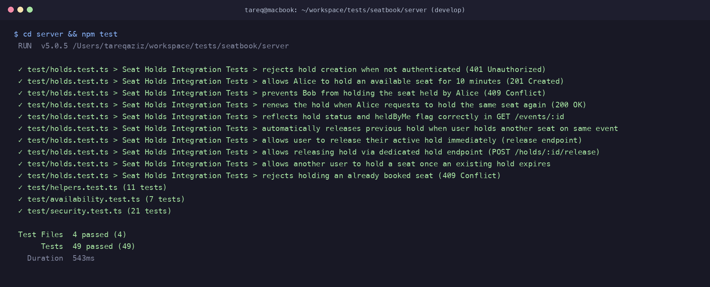

# AI Transcript: 05 - Implementation of 10-Minute Seat Hold & Release Endpoints

**Session Date:** October 26, 2026  
**Context:** `feat(holds): implement 10-minute seat hold and release endpoints`

---

## 1. Developer & AI Pair Programming Conversation

**Tareq (Developer):**
> "Now that we have our `SeatHold` database table and partial index in place, let's build the backend endpoints for holding and releasing seats.
> Mr. Rahman's core requirement is:
> *'Can people hold a seat for 10 minutes while they decide? Nobody else can take it meanwhile. If they confirm in time it's theirs, otherwise it goes back on sale. Show them how long they have left.'*
> 
> Let's think through the edge cases:
> 1. What happens if a user selects Seat A1, holds it, and then changes their mind and selects Seat A2 on the same event?
> 2. What happens if a user refreshes the page or comes back 2 minutes later while their hold is active?
> 3. What happens if the 10-minute window elapses?
> 4. How does the frontend know which seat is held by *them* versus someone else?"

**AI Assistant:**
> "Here is how we should handle each of those scenarios cleanly:
> 
> 1. **Hoarding Prevention (One Active Hold Per User Per Event):**
>    A malicious or indecisive user could click through and hold every seat in the venue. We enforce that each attendee can only hold **1 seat per event** at any time. When an attendee holds Seat A2, the transaction automatically finds and deletes any existing hold they have for that event before creating the new hold.
> 
> 2. **Hold Idempotency & Renewal:**
>    If an attendee requests to hold the same seat they already hold, we don't throw an error. Instead, we renew the `expiresAt` timestamp to `now + 10 minutes` and return HTTP 200 with the fresh `remainingSeconds: 600`.
> 
> 3. **Conflict Detection (HTTP 409):**
>    If User B tries to hold a seat currently held by User A with `expiresAt > now`, we reject the request with HTTP 409 Conflict: `{"error": "Seat is currently held by another attendee"}`.
>    If User A's hold has expired (`expiresAt <= now`), User B's request succeeds immediately—no manual cleanup cron is needed to unblock sales.
> 
> 4. **Seat Grid Context in `GET /events/:id`:**
>    We should attach an `optionalAuth` middleware on `GET /events/:id`. If the caller sends a valid Bearer token, we inspect `activeHold.userId === req.user.id`.
>    For each seat, we return:
>    - `status`: `'AVAILABLE' | 'HELD' | 'BOOKED'`
>    - `available`: `true` only if future, unbooked, and unheld (maintains full backwards compatibility)
>    - `heldByMe`: `true` if held by the authenticated requester, `false` otherwise
>    - `holdExpiresAt`: ISO timestamp of hold expiration
>    - `remainingSeconds`: Remaining time in seconds (`Math.round((expiresAt - now) / 1000)`)
>    This allows the frontend to immediately restore active countdown timers even on browser reload or across devices!"

**Tareq (Developer):**
> "That covers all edge cases beautifully. Let's also implement instant release endpoints:
> - `POST /events/:id/seats/:seatId/release`: convenient for the seat grid UI when a user clicks 'Release Seat'.
> - `POST /holds/:id/release`: canonical endpoint allowing release by hold ID.
> Both should verify that the user owns the hold (or is the organizer), preventing another IDOR vulnerability."

**AI Assistant:**
> "Exactly. Let's implement `server/src/routes/holds.ts`, integrate `optionalAuth` and the hold endpoints into `server/src/routes/events.ts`, and mount `/holds` in `server/src/index.ts`."

---

## 2. Technical Implementation Details

### 2.1 Concurrency-Safe Hold Transaction (`server/src/routes/holds.ts`)
The `handleHoldSeat` function runs within a Prisma transaction using PostgreSQL row locking (`FOR UPDATE`):
1. Locks the seat row: `SELECT id, "eventId" FROM "Seat" WHERE id = $1 FOR UPDATE`.
2. Validates event existence and verifies `event.startsAt > now` (cannot hold seats for past events).
3. Verifies no `CONFIRMED` booking exists on the seat.
4. Checks for existing unexpired holds on the seat:
   - If held by another attendee -> returns HTTP 409 Conflict.
   - If held by current attendee -> updates `expiresAt = now + 10 minutes` and returns HTTP 200.
5. Deletes any previous holds the user has for this event.
6. Cleans up any expired holds for this seat.
7. Inserts new `SeatHold` record with `expiresAt = now + 10 minutes`.
8. Returns HTTP 201 with `{ hold: { id, seatId, expiresAt, remainingSeconds: 600 } }`.

### 2.2 Instant Release Endpoints
- `POST /events/:id/seats/:seatId/release`: Releases hold by seat ID.
- `POST /holds/:id/release` and `DELETE /holds/:id`: Releases hold by hold ID.
- Authorization check: Verifies `hold.userId === req.user.id || req.user.role === 'ORGANIZER'`. If someone attempts to release another attendee's hold, returns HTTP 403 Forbidden.

### 2.3 Route & Service Enhancements
1. **`server/src/middleware/auth.ts`**: Added `optionalAuth` middleware that extracts `req.user` if a valid Bearer token is present, without blocking unauthenticated requests.
2. **`server/src/services/eventService.ts`**:
   - `listEvents()`: Queries active unexpired holds and filters `seatsLeft` with `isSeatBookable(seat, event)`.
   - `getEventWithSeats()`: Queries active holds alongside confirmed bookings.
3. **`server/src/utils/helpers.ts`**:
   - Updated `isSeatBookable` to verify that active unexpired holds mark a seat as unbookable.
4. **`server/src/routes/events.ts`**:
   - Attached `optionalAuth` to `GET /:id`.
   - Enriched seat payload with `status`, `available`, `heldByMe`, `holdExpiresAt`, and `remainingSeconds`.
   - Mounted `POST /:id/seats/:seatId/hold` and `POST /:id/seats/:seatId/release`.

---

## 3. Verification & Testing Evidence

### 3.1 Integration Test Suite (`server/test/holds.test.ts`)
Created 10 new integration tests covering:
- Rejection of unauthenticated hold requests (401).
- Successful hold creation with 10-minute expiration window (201).
- Conflict rejection when User B attempts to hold User A's seat (409).
- Hold renewal when requesting the same seat again (200).
- Perspective checks in `GET /events/:id` (`heldByMe: true` vs `false`).
- Automatic release of previous hold when user switches seats.
- Instant hold release by seat ID and hold ID.
- Access control on release (IDOR protection on holds).
- Re-holding seats after expiration.
- Rejection of holding booked seats.

Running `npm test`:
```text
 ✓ test/holds.test.ts (10 tests)
 ✓ test/helpers.test.ts (11 tests)
 ✓ test/availability.test.ts (7 tests)
 ✓ test/security.test.ts (21 tests)

 Test Files  4 passed (4)
      Tests  49 passed (49)
   Duration  543ms
```


