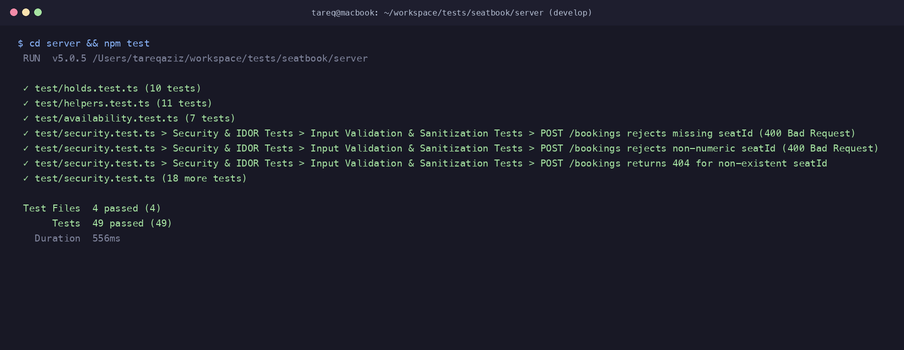

# AI Transcript: 06 - Enforcing Hold Checks and Transactional Seat Locks in Bookings

**Session Date:** October 26, 2026  
**Context:** `feat(bookings): enforce hold checks and transactional seat locks`

---

## 1. Developer & AI Pair Programming Conversation

**Tareq (Developer):**
> "Let's look at `POST /bookings` in `server/src/routes/bookings.ts`.
> In the original prototype, booking a seat was implemented with a basic check-then-insert pattern:
> ```typescript
> const existing = await prisma.booking.findFirst({
>   where: { seatId: seat.id, status: 'CONFIRMED' },
> });
> if (existing) return res.status(409).json({ error: 'Seat already booked' });
> const booking = await prisma.booking.create(...);
> ```
> There are two major issues here:
> 1. **Concurrency Race Condition:** If Alice and Bob submit a booking for the same seat at the exact same millisecond, both read `existing === null` before either write completes. Both bookings are inserted as `CONFIRMED`.
> 2. **Hold Bypass Vulnerability:** The booking endpoint did not check `SeatHold` at all! So even if Alice had held a seat for 10 minutes, Bob could bypass the hold by directly sending `POST /bookings` with `seatId`.
> 
> How should we re-architect `POST /bookings`?"

**AI Assistant:**
> "We should wrap the entire booking process into an interactive Prisma transaction (`prisma.$transaction`) with pessimistic row locking:
> 
> 1. **Pessimistic Row Lock (`SELECT ... FOR UPDATE`):**
>    Inside the transaction, we first run:
>    ```sql
>    SELECT id, "eventId" FROM "Seat" WHERE id = $1 FOR UPDATE
>    ```
>    In PostgreSQL, `FOR UPDATE` locks the seat row until the transaction commits or rolls back. Any competing transaction trying to lock or book the same seat is blocked at the database level and forced to wait in line.
> 
> 2. **Precondition Validations inside Lock:**
>    - Verify the seat exists and the event has not started.
>    - Check for an existing `CONFIRMED` booking.
> 
> 3. **Hold Verification:**
>    - Check if there is an active hold on this seat (`expiresAt > now`).
>    - If an active hold exists and belongs to someone else (`activeHold.userId !== req.user.id`), reject with HTTP 409 Conflict: `{"error": "Seat is currently held by another attendee"}`.
>    - If the hold belongs to the requesting attendee (or the seat is completely unheld), allow the booking to proceed!
> 
> 4. **State Transition & Hold Cleanup:**
>    - Insert the `CONFIRMED` booking.
>    - Delete the `SeatHold` row for this seat so the seat is now permanently occupied by the booking rather than temporarily held.
> 
> 5. **PostgreSQL Partial Unique Index as Absolute Safety Net:**
>    Even if an unexpected runtime anomaly occurred, the database's `unique_active_booking_per_seat` index guarantees that two `CONFIRMED` bookings cannot exist for the same seat. We catch Prisma error code `P2002` and gracefully return HTTP 409."

**Tareq (Developer):**
> "That completely seals both the race condition and the hold bypass vulnerability. Let's update `server/src/routes/bookings.ts` and test it."

---

## 2. Technical Implementation Details

### 2.1 Refactored `POST /bookings` (`server/src/routes/bookings.ts`)
```typescript
router.post('/', requireAuth, async (req: AuthRequest, res) => {
  try {
    const { seatId } = req.body;
    const seatIdNum = Number(seatId);

    if (!seatId || isNaN(seatIdNum) || seatIdNum <= 0 || !Number.isInteger(seatIdNum)) {
      return res.status(400).json({ error: 'Valid seatId is required' });
    }

    const userId = req.user!.id;

    const result = await prisma.$transaction(async (tx) => {
      // 1. Lock the Seat row to serialize concurrent booking and hold operations
      const seats = await tx.$queryRaw<Array<{ id: number; eventId: number }>>`
        SELECT id, "eventId" FROM "Seat" WHERE id = ${seatIdNum} FOR UPDATE
      `;

      if (!seats || seats.length === 0) {
        return { status: 404, data: { error: 'Seat not found' } };
      }

      const seat = seats[0];

      // 2. Fetch event to verify it exists and hasn't started yet
      const event = await tx.event.findUnique({ where: { id: seat.eventId } });
      if (!event) {
        return { status: 404, data: { error: 'Event not found' } };
      }

      if (new Date(event.startsAt) < new Date()) {
        return {
          status: 400,
          data: { error: 'This event has already started', msg: 'This event has already started' },
        };
      }

      // 3. Check for existing active CONFIRMED booking
      const existing = await tx.booking.findFirst({
        where: { seatId: seat.id, status: 'CONFIRMED' },
      });

      if (existing) {
        return { status: 409, data: { error: 'Seat already booked' } };
      }

      // 4. Check for active unexpired hold by another attendee
      const activeHold = await tx.seatHold.findFirst({
        where: {
          seatId: seat.id,
          expiresAt: { gt: new Date() },
        },
      });

      if (activeHold && activeHold.userId !== userId) {
        return {
          status: 409,
          data: { error: 'Seat is currently held by another attendee' },
        };
      }

      // 5. Create the confirmed booking
      const booking = await tx.booking.create({
        data: {
          seatId: seat.id,
          userId,
          status: 'CONFIRMED',
        },
      });

      // 6. Release any holds on this seat (held by this user or expired)
      await tx.seatHold.deleteMany({
        where: { seatId: seat.id },
      });

      return { status: 201, data: booking };
    });

    return res.status(result.status).json(result.data);
  } catch (err: any) {
    if (err.code === 'P2002' || err.message?.includes('unique_active_booking_per_seat')) {
      return res.status(409).json({ error: 'Seat already booked' });
    }
    console.error('Error creating booking:', err);
    res.status(500).json({ error: err.message || 'Internal server error while creating booking' });
  }
});
```

---

## 3. Verification & Testing Evidence

### 3.1 Automated Test Suite
Running `npm test` across all suites:
```text
 ✓ test/holds.test.ts (10 tests)
 ✓ test/helpers.test.ts (11 tests)
 ✓ test/availability.test.ts (7 tests)
 ✓ test/security.test.ts (21 tests)

 Test Files  4 passed (4)
      Tests  49 passed (49)
   Duration  556ms
```


