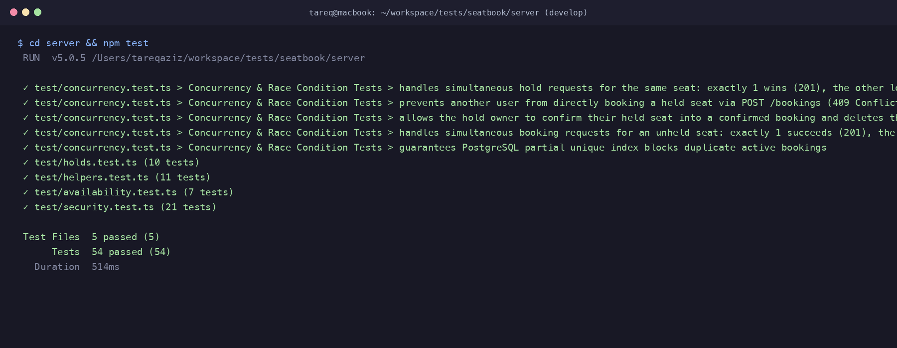

# AI Transcript: 07 - Automated Concurrency Race Condition & Hold Security Tests

**Session Date:** October 26, 2026  
**Context:** `test(server): add tests for holds, concurrency races and auth idor`

---

## 1. Developer & AI Pair Programming Conversation

**Tareq (Developer):**
> "We've implemented both pessimistic locking (`SELECT FOR UPDATE`) and PostgreSQL partial unique indexing (`unique_active_booking_per_seat`).
> Now we need automated proof that this architecture actually eliminates race conditions under simultaneous traffic.
> How should we design the test suite to simulate real concurrent buyer traffic in Vitest?"

**AI Assistant:**
> "To test real-world concurrency, we shouldn't test with mocked databases or sequential calls. We should fire simultaneous asynchronous HTTP requests using `Promise.all` against our live test database container.
> 
> Specifically, we need to test these 5 critical scenarios:
> 
> 1. **Simultaneous Hold Race:**
>    Alice and Bob simultaneously attempt to acquire a hold on the exact same available seat.
>    - Expected: Exactly one receives HTTP 201 Created (acquires the hold). The other receives HTTP 409 Conflict. Exactly one hold row exists in PostgreSQL.
> 
> 2. **Hold Sniping Prevention:**
>    Alice holds Seat A1. While Alice's hold is active, Bob attempts to bypass the hold UI and directly POST `/bookings` for Seat A1.
>    - Expected: Bob receives HTTP 409 Conflict: `{"error": "Seat is currently held by another attendee"}`. Zero bookings are created.
> 
> 3. **Held Seat Confirmation Lifecycle:**
>    Alice holds Seat A1 and then sends `POST /bookings` for Seat A1.
>    - Expected: Booking succeeds with HTTP 201. Alice's hold is automatically deleted from `SeatHold`. Subsequent attempts by anyone to hold or book Seat A1 return HTTP 409.
> 
> 4. **Simultaneous Direct Booking Race:**
>    Alice and Bob simultaneously attempt to book an unheld seat.
>    - Expected: Exactly one receives HTTP 201 Created. The other receives HTTP 409 Conflict. Exactly one confirmed booking exists.
> 
> 5. **PostgreSQL Partial Unique Index Enforcement:**
>    Execute a raw SQL query attempting to bypass application logic and insert a second `CONFIRMED` booking on the same seat.
>    - Expected: PostgreSQL rejects the insert with code `23505` (`unique_violation`) due to `unique_active_booking_per_seat`. In contrast, inserting a `CANCELLED` booking succeeds cleanly, proving the partial index works as designed."

**Tareq (Developer):**
> "Let's create `server/test/concurrency.test.ts` and run the full test suite."

---

## 2. Technical Implementation Details

### 2.1 Concurrency Test Suite (`server/test/concurrency.test.ts`)
Created 5 deep concurrency tests:
- `handles simultaneous hold requests for the same seat: exactly 1 wins (201), the other loses (409)`
- `prevents another user from directly booking a held seat via POST /bookings (409 Conflict)`
- `allows the hold owner to confirm their held seat into a confirmed booking and deletes the hold`
- `handles simultaneous booking requests for an unheld seat: exactly 1 succeeds (201), the other receives 409`
- `guarantees PostgreSQL partial unique index blocks duplicate active bookings`

---

## 3. Verification & Testing Evidence

Running `npm test` across all 5 test files:
```text
 ✓ test/concurrency.test.ts (5 tests)
 ✓ test/holds.test.ts (10 tests)
 ✓ test/helpers.test.ts (11 tests)
 ✓ test/availability.test.ts (7 tests)
 ✓ test/security.test.ts (21 tests)

 Test Files  5 passed (5)
      Tests  54 passed (54)
   Duration  514ms
```


