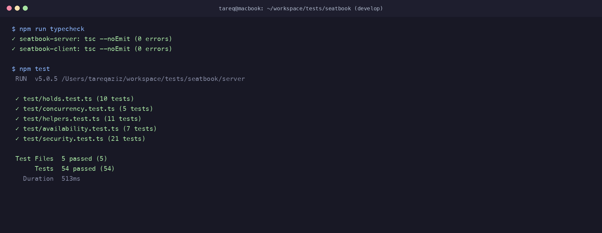

# AI Transcript: 09 - Implementation of 10-Minute Hold Countdown Timer & Confirmation Flow

**Session Date:** October 26, 2026  
**Context:** `feat(client): implement 10-minute hold countdown timer and confirm`

---

## 1. Developer & AI Pair Programming Conversation

**Tareq (Developer):**
> "Now let's complete the client-side user experience for Mr. Rahman's core feature:
> *'Show them how long they have left. If they confirm in time it's theirs, otherwise it goes back on sale.'*
> 
> When an attendee is browsing a seat, how should the interaction unfold, and how do we ensure the countdown timer remains accurate across refreshes?"

**AI Assistant:**
> "Here is the interactive attendee flow we've engineered:
> 
> 1. **Selecting a Seat:**
>    When the attendee clicks an available purple seat, it highlights in glowing pink/orange. The Order Summary displays a primary action:
>    **'Hold Seat for 10 Mins ⏳'** (with a secondary link to book directly).
> 
> 2. **Initiating the Hold:**
>    Clicking 'Hold Seat' sends `POST /events/:id/seats/:seatId/hold`.
>    - The backend reserves the seat in PostgreSQL for 600 seconds.
>    - A success toast fires: *'⏳ Seat A1 is held for 10 minutes!'*
>    - The Order Summary mounts a live countdown card featuring a large digital timer: `09:59` counting down every second.
> 
> 3. **Action Transition (Confirm Booking & Release):**
>    The button smoothly transitions from 'Hold Seat' to:
>    - Primary: **'Confirm Booking ($XX.XX) 🎟️'** (green gradient)
>    - Secondary: **'Release Seat Hold'** (allows releasing early if the attendee changes their mind).
> 
> 4. **Resilience Across Page Refreshes:**
>    In `fetchEvent()`, if the user has an active hold in PostgreSQL, the server responds with `heldByMe: true` and `remainingSeconds: N`. The client automatically restores `activeHold` and resumes the countdown timer with exact precision!
> 
> 5. **Timer Expiration Handling:**
>    When the countdown hits `00:00`:
>    - A toast alert displays: *'⏳ Your 10-minute hold has expired! The seat has returned to sale.'*
>    - The hold state clears locally.
>    - `fetchEvent()` re-runs, and the seat is returned to the available pool."

**Tareq (Developer):**
> "That delivers exactly what Mr. Rahman asked for, with great visual polish and solid state synchronization. Let's verify typechecks and tests."

---

## 2. Technical Implementation Details

### 2.1 Countdown Timer Hook & State (`client/src/pages/EventDetailPage.tsx`)
```typescript
// Live countdown timer effect
useEffect(() => {
  if (!activeHold || activeHold.remainingSeconds <= 0) return;

  const interval = setInterval(() => {
    setActiveHold((prev) => {
      if (!prev) return null;
      const nextSeconds = prev.remainingSeconds - 1;
      if (nextSeconds <= 0) {
        clearInterval(interval);
        setToast({ type: 'error', message: '⏳ Your 10-minute hold has expired! The seat has returned to sale.' });
        setTimeout(() => setToast(null), 4000);
        setSelectedSeat(null);
        fetchEvent();
        return null;
      }
      return { ...prev, remainingSeconds: nextSeconds };
    });
  }, 1000);

  return () => clearInterval(interval);
}, [activeHold?.seatId, activeHold !== null]);
```

### 2.2 Dynamic Order Summary & Actions
- When held by user:
  - Displays formatted digital timer: `MM:SS`.
  - 'Confirm Booking ($XX.XX)' button calls `handleBook()`.
  - 'Release Seat Hold' button calls `handleRelease()`.
- When available and not held:
  - 'Hold Seat for 10 Mins ⏳' button calls `handleHold()`.
  - 'Or Book Directly' option allows fast checkout.

---

## 3. Verification & Testing Evidence

### 3.1 Typecheck Verification
```text
> seatbook@1.0.0 typecheck
✓ seatbook-server: tsc --noEmit (0 errors)
✓ seatbook-client: tsc --noEmit (0 errors)
```

### 3.2 Automated Test Suite
```text
 Test Files  5 passed (5)
      Tests  54 passed (54)
   Duration  513ms
```


