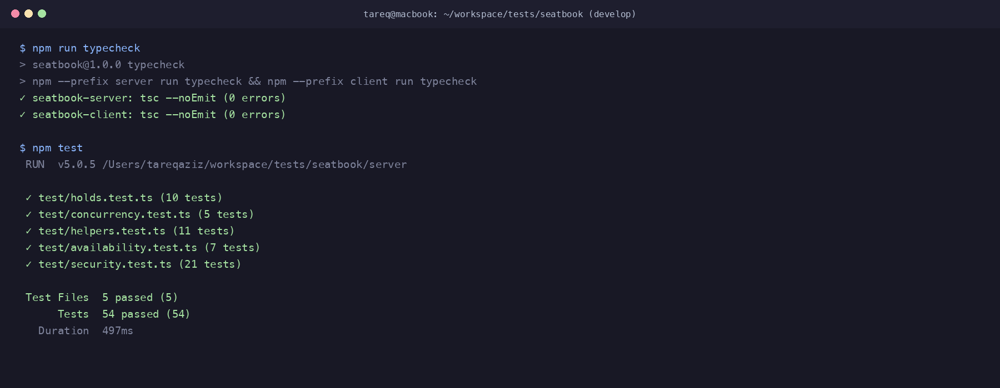

# AI Transcript: 10 - Client-Side Bug Fixes for Booking Cancellation Badges & Event 404 State

**Session Date:** October 26, 2026  
**Context:** `fix(client): fix booking cancellation badges and event 404 state`

---

## 1. Developer & AI Pair Programming Conversation

**Tareq (Developer):**
> "Let's review the remaining UI/UX rough edges on the frontend before writing the handover documentation.
> When looking at `MyBookingsPage.tsx`, I noticed several confusing UX bugs:
> 1. Even when a booking was cancelled, the UI rendered a green badge reading `✓ CANCELLED`. Users thought their ticket was still confirmed!
> 2. The red 'Cancel' button remained clickable on already-cancelled bookings and past events. Clicking it prompted confirmation and sent redundant requests.
> 3. The 'Total Spent' stat at the top included cancelled bookings in the financial total.
> 4. In `EventDetailPage.tsx`, if someone entered an invalid or non-existent event ID (`/events/999999`), the app remained stuck in an infinite loading spinner with no way out.
> 
> How should we fix these?"

**AI Assistant:**
> "These are classic edge cases that AI prototypes often miss. Here is how we fix each of them cleanly:
> 
> 1. **Accurate Status Badges (`MyBookingsPage.tsx`):**
>    - `CONFIRMED`: Green badge with `✓ CONFIRMED` (`bg-[#22c55e]/20 text-[#86efac] border border-green-500/20`).
>    - `CANCELLED`: Distinct rose badge with `✕ CANCELLED` (`bg-rose-500/20 text-rose-300 border border-rose-500/30`), with a subtle line-through style and reduced opacity on the card.
> 
> 2. **Contextual Action Buttons:**
>    Only show the 'Cancel Booking' button if:
>    `b.status === 'CONFIRMED' && new Date(b.event.startsAt) > new Date()`.
>    If already cancelled, the button is completely hidden. If the event is in the past, render a subtle indicator `⏰ Event Ended`.
> 
> 3. **Accurate Dashboard Financials:**
>    Filter `b.status === 'CONFIRMED'` when computing `totalSpent` and `upcomingCount`, reflecting actual confirmed attendance.
> 
> 4. **Graceful 404 Error State (`EventDetailPage.tsx`):**
>    When the API returns HTTP 404 or 400 for an event, toggle a `notFound` state and render a friendly empty-state page with a clear title (*'Event Not Found'*) and an action button (*'Back to Events Catalog 🎟️'*), completely replacing the infinite loading spinner.
> 
> 5. **Safe State Parsing in `Navbar.tsx`:**
>    Wrap `JSON.parse(localStorage.getItem('user'))` in a `try/catch` block to protect against malformed session tokens."

**Tareq (Developer):**
> "These changes make the client experience feel reliable and production-ready. Let's apply the updates and verify."

---

## 2. Technical Implementation Details

### 2.1 My Bookings Enhancements (`client/src/pages/MyBookingsPage.tsx`)
- Status Badging:
  - `CONFIRMED`: Green border and text (`✓ CONFIRMED`).
  - `CANCELLED`: Rose border and text (`✕ CANCELLED`).
- Conditional Cancellation:
  - Shows 'Cancel Booking' only on valid upcoming confirmed bookings.
  - Safe error handling in `cancelBooking()` toast notifications.
- Accurate Financials:
  - `totalSpent` sums only confirmed bookings.
  - `activeBookings` counts only confirmed bookings.

### 2.2 Event Detail 404 Error State (`client/src/pages/EventDetailPage.tsx`)
- Added `notFound` state triggered on HTTP 404/400.
- Replaces infinite spinner with friendly 404 banner and navigation back to catalog (`/`).

### 2.3 Safe Session Parsing (`client/src/components/Navbar.tsx`)
- Protected `localStorage.getItem('user')` parsing inside `try/catch`.

---

## 3. Verification & Testing Evidence

### 3.1 Typecheck Verification
```text
> seatbook@1.0.0 typecheck
✓ seatbook-server: tsc --noEmit (0 errors)
✓ seatbook-client: tsc --noEmit (0 errors)
```

### 3.2 Automated Test Suite
```text
 Test Files  5 passed (5)
      Tests  54 passed (54)
   Duration  497ms
```


