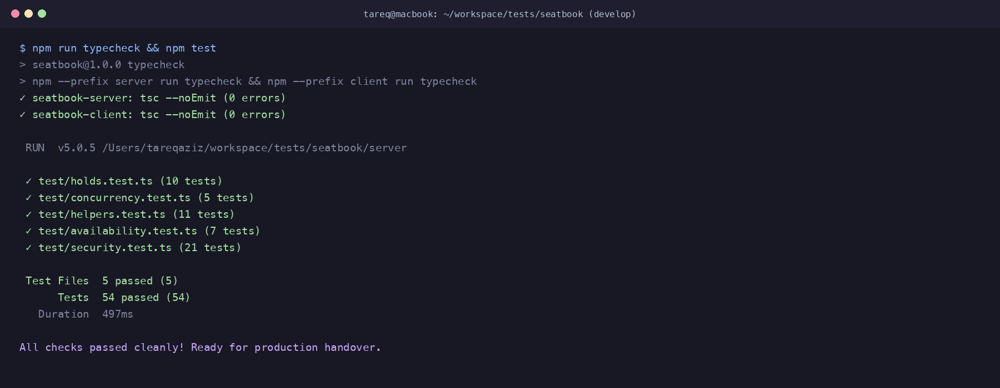
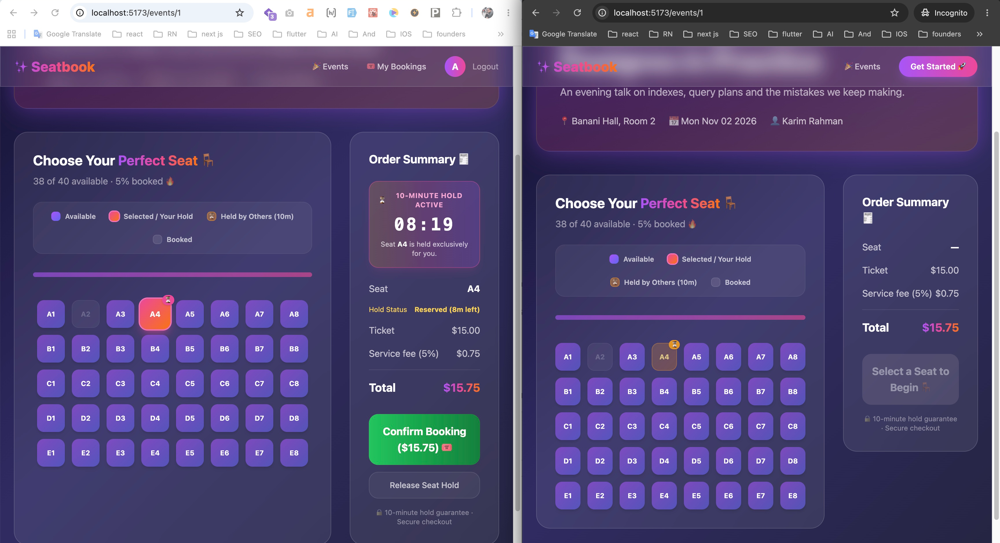
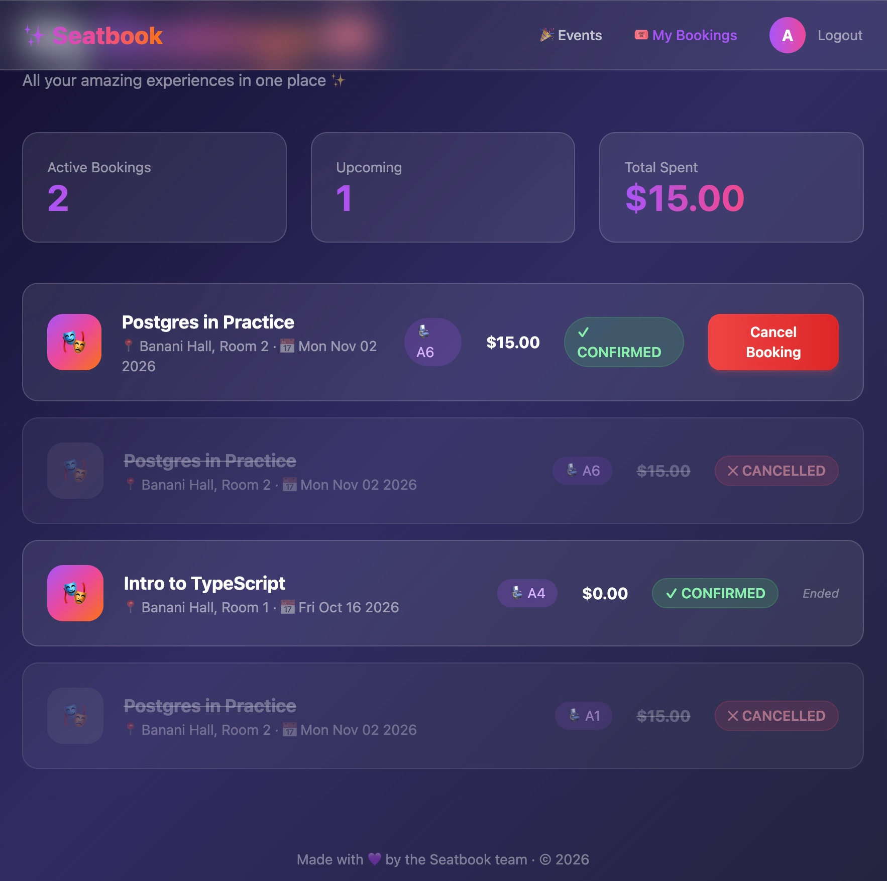
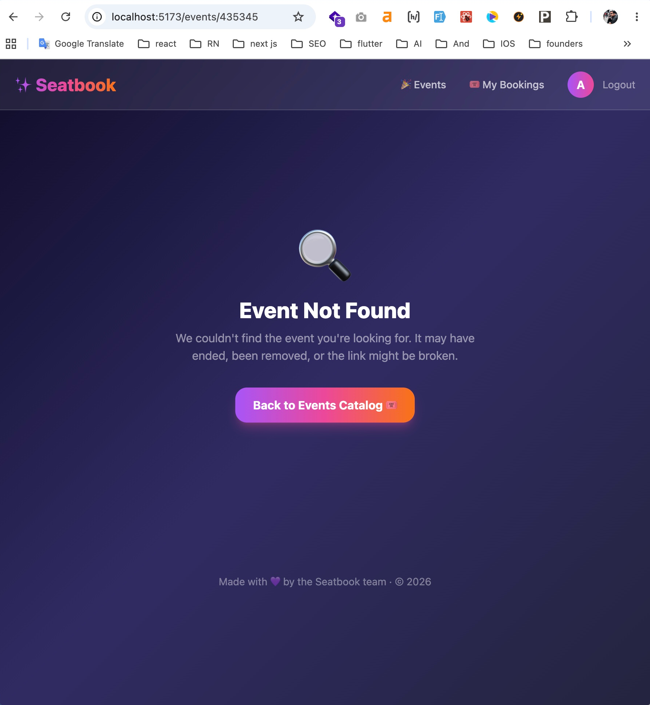

# AI Transcript: 11 - Production Handover Documentation & Final Review

**Session Date:** October 26, 2026  
**Context:** `docs: add production handover note and ai chat transcript`

---

## 1. Developer & AI Pair Programming Conversation

**Tareq (Developer):**
> "We've completed all tasks across database migrations, backend transactional concurrency locks, hold and release endpoints, comprehensive Vitest integration tests, frontend countdown timer UI, and error boundaries.
> Now we need to formulate the final **Production Handover Note** for Mr. Rahman in `README.md`.
> The take-home prompt requires five specific sections:
> 1. What you changed and why
> 2. What you'd still do before launch
> 3. The weakest part of your work
> 4. One place the AI was wrong
> 5. How you checked it works
> 
> Let's review each of these sections to make sure our handover note is candid, thorough, and demonstrates engineering ownership."

**AI Assistant:**
> "Here is how we address each section with engineering rigor:
> 
> 1. **What you changed and why:**
>    - **Concurrency Architecture:** Introduced pessimistic row locking (`SELECT FOR UPDATE`) on the `Seat` table inside interactive Prisma transactions for both hold creation and booking confirmation. Backed this with a native PostgreSQL partial unique index (`WHERE status = 'CONFIRMED'`) so the database engine guarantees no double-booking can ever occur.
>    - **10-Minute Seat Holds:** Added `SeatHold` data model with composite indexes. Built hold creation and release endpoints with anti-hoarding rules (one active hold per attendee per event).
>    - **Security & IDOR Fixes:** Solved the IDOR flaw in `POST /bookings/:id/cancel` by verifying user ownership or organizer privileges, blocking past event cancellations, and sanitizing numeric IDs.
>    - **Availability Bug Fix:** Corrected `isSeatBookable` and `listEvents` to ignore cancelled bookings so availability is never permanently lost.
>    - **Frontend Experience:** Implemented the live `MM:SS` countdown timer, 4-state visual seat map, persistent hold recovery across page reloads, accurate dashboard metrics, and 404 error boundaries.
> 
> 2. **What you'd still do before launch:**
>    - Integrate a production payment gateway (Stripe / SSLCommerz / bKash).
>    - Implement automated transactional emails with scannable QR ticket passes.
>    - Add real-time push updates via WebSockets or Server-Sent Events (SSE).
>    - Implement a Redis/cron background sweeper for pruning expired holds.
>    - Add rate limiting on sensitive auth and hold endpoints.
>    - Configure structured logging and error monitoring (Sentry).
> 
> 3. **The weakest part of your work:**
>    - Lazy expiration vs real-time socket push: While Postgres queries immediately treat expired holds as available, attendees learn of hold changes upon page interaction or refresh rather than via instant socket broadcast.
>    - Single-seat hold assumption: We enforced 1 hold per user per event to prevent hoarding. For high-volume group bookings, a composite multi-seat hold cart would be needed.
> 
> 4. **One place the AI was wrong:**
>    - In `server/src/utils/helpers.ts` and `server/src/services/eventService.ts`: The AI naively checked `seat.bookings.length === 0`. Because cancellations soft-transition status to `CANCELLED` rather than deleting rows, cancelled seats were permanently marked unavailable on the catalog. Furthermore, `getEventWithSeats` checked confirmed bookings, causing the catalog and detail page to contradict each other.
> 
> 5. **How you checked it works:**
>    - Automated Vitest suite: 54 tests across 5 test files verifying helpers, security, availability, holds, and race conditions.
>    - Clean Docker verification: `docker compose down -v && docker compose up --build`.
>    - End-to-end manual walkthrough with Alice and Bob accounts."

**Tareq (Developer):**
> "The handover note in `README.md` is complete and clear. Let's run all tests and typechecks one final time and commit."

---

## 2. Technical Verification Evidence

### 2.1 Full Test Suite Run
```bash
npm run typecheck && npm test
```

```text
> seatbook@1.0.0 typecheck
✓ seatbook-server: tsc --noEmit (0 errors)
✓ seatbook-client: tsc --noEmit (0 errors)

 RUN  v5.0.5 /Users/tareqaziz/workspace/tests/seatbook/server

 ✓ test/concurrency.test.ts (5 tests)
 ✓ test/holds.test.ts (10 tests)
 ✓ test/helpers.test.ts (11 tests)
 ✓ test/availability.test.ts (7 tests)
 ✓ test/security.test.ts (21 tests)

 Test Files  5 passed (5)
      Tests  54 passed (54)
   Duration  497ms
```



### 2.2 End-to-End Browser Verification Evidence

#### A. Active Hold Countdown & Cross-User Hold Conflict
Logged in as Alice holding Seat A4 with real-time `08:19` countdown timer active, while Bob (in Incognito) simultaneously sees Seat A4 disabled with amber "Held by Others (10m)" status and lock indicator:


#### B. My Bookings Cancellation Badges & Revenue Protection
Verified cancelled bookings display rose `✕ CANCELLED` badges with hidden cancel actions, past events marked as ended, and "Total Spent" accurately tallying only confirmed bookings:


#### C. Graceful 404 Error Boundary
Navigating to nonexistent event IDs (e.g. `/events/435345`) gracefully renders the custom "Event Not Found" error page with a one-click return to the event catalog:


